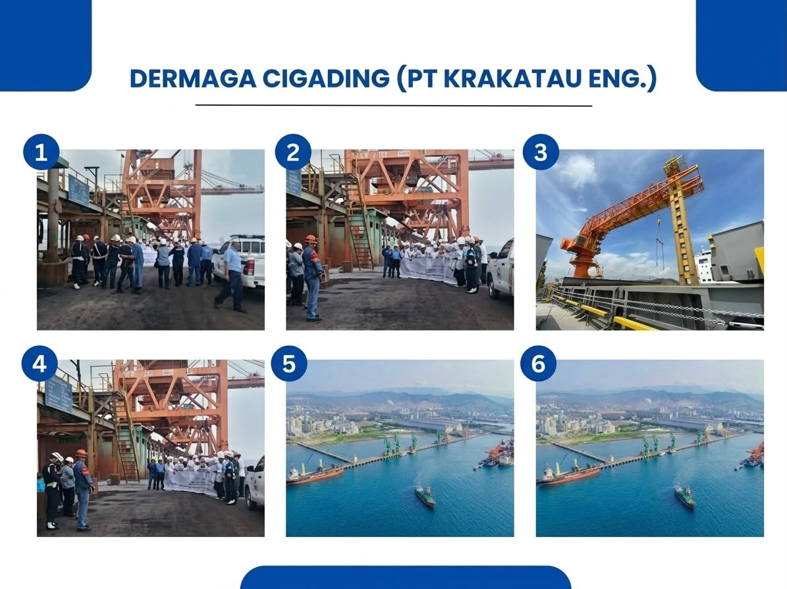
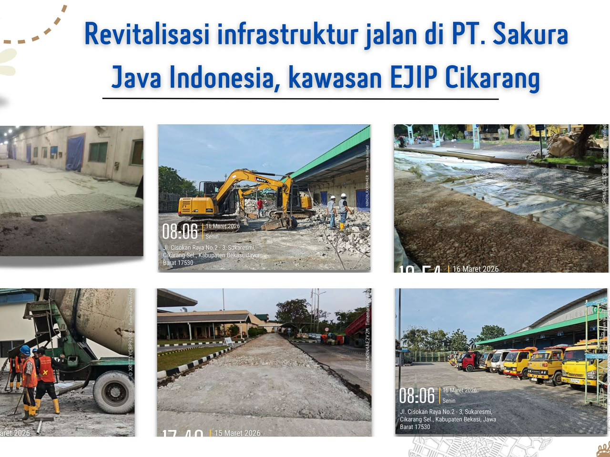
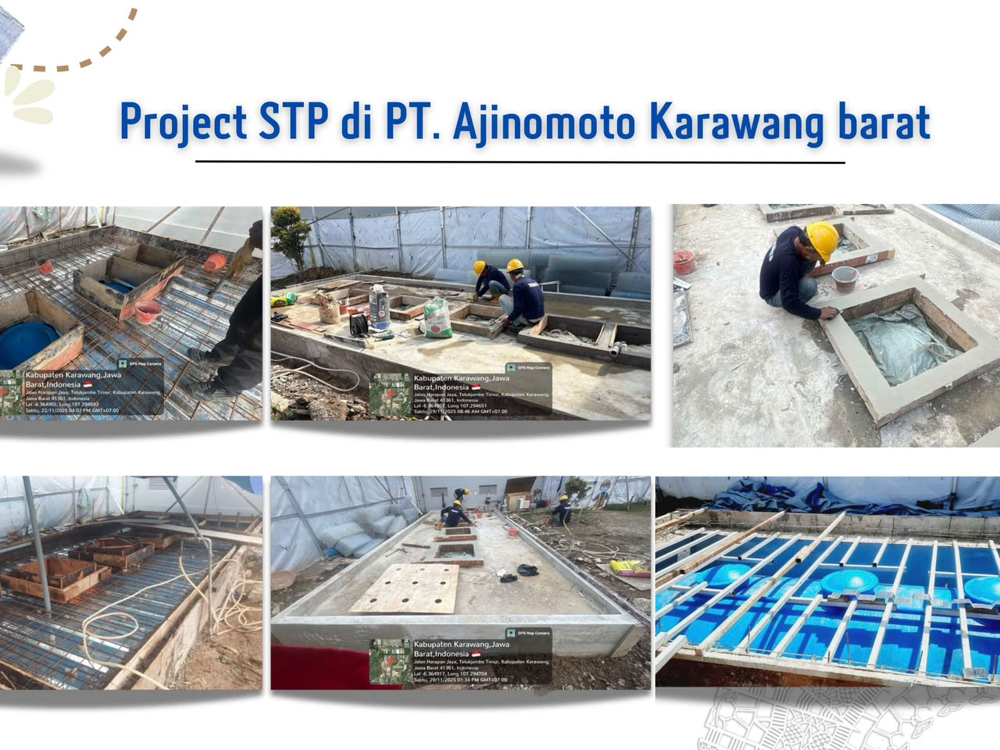
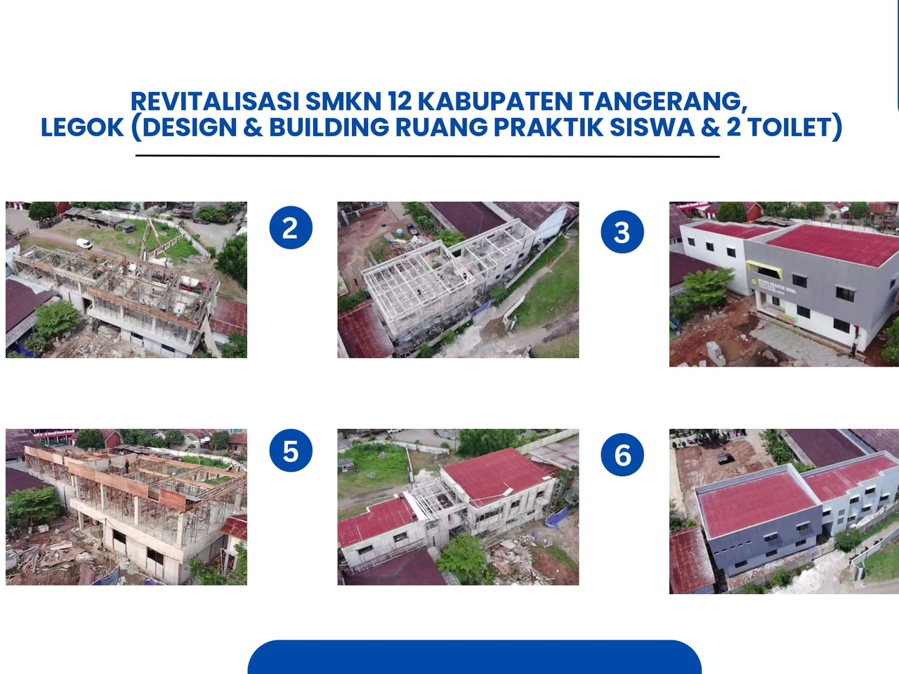
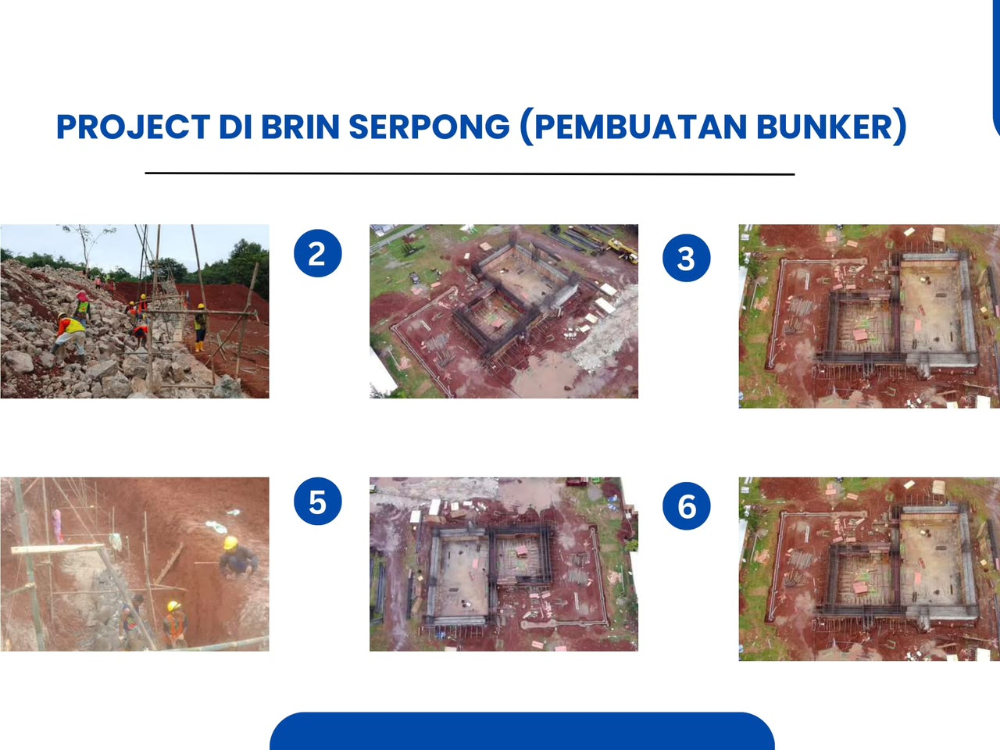
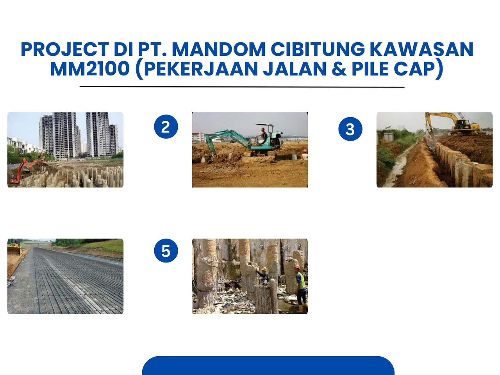

<!DOCTYPE html>
<html lang="id" class="scroll-smooth">
<head>
    <meta charset="UTF-8">
    <meta name="viewport" content="width=device-width, initial-scale=1.0">
    <!-- UBAH TEKS JUDUL WEBSITE DI SINI -->
    <title>PT. Bangun Manunggal Trisno | Kontraktor & Suplier</title>
    
    <!-- Menggunakan Tailwind CSS untuk Styling -->
    
    
    <!-- Menggunakan FontAwesome untuk Ikon -->
    <link rel="stylesheet" href="https://cdnjs.cloudflare.com/ajax/libs/font-awesome/6.4.0/css/all.min.css">
    
    <!-- Menggunakan Font Google (Inter) -->
    <link href="https://fonts.googleapis.com/css2?family=Inter:wght@300;400;600;700&display=swap" rel="stylesheet">
    
    
    
    <!-- Konfigurasi Warna Khusus (Biru Tua & Biru Muda) -->
    
</head>
<body class="bg-gray-50 text-gray-800">

    <!-- ============================================== -->
    <!-- BAGIAN HEADER & NAVIGASI                       -->
    <!-- ============================================== -->
    <header id="navbar" class="fixed w-full top-0 z-50 bg-white shadow-md transition-all duration-300">
        

            

                
                <!-- UBAH LOGO PERUSAHAAN DI SINI -->
                

                    <!-- Jika ingin memakai gambar logo, hapus ikon <i...> dan gunakan tag  di bawah ini: -->
                     (Rekomendasi: 200x60px) -->
                    
                    

                        B
                    

                    <!-- UBAH NAMA PERUSAHAAN DI SINI -->
                    PT. Bangun Manunggal Trisno
                

                <!-- Menu Navigasi -->
                <nav class="hidden md:flex space-x-8">
                    <a href="#beranda" class="text-gray-600 hover:text-secondary font-semibold transition">Beranda</a>
                    <a href="#tentang" class="text-gray-600 hover:text-secondary font-semibold transition">Tentang Kami</a>
                    <a href="#layanan" class="text-gray-600 hover:text-secondary font-semibold transition">Layanan</a>
                    <a href="#proyek" class="text-gray-600 hover:text-secondary font-semibold transition">Proyek</a>
                    <a href="#kontak" class="text-gray-600 hover:text-secondary font-semibold transition">Kontak</a>
                </nav>

                <!-- Tombol CTA Navigasi -->
                

                    <a href="https://wa.me/6281284186229" target="_blank" class="bg-secondary text-white px-6 py-2 rounded-full font-semibold hover:bg-primary transition shadow-lg">
                        Hubungi Kami
                    </a>
                

            

        

    </header>

    <!-- ============================================== -->
    <!-- BAGIAN HERO (BERANDA)                          -->
    <!-- ============================================== -->
    <section id="beranda" class="pt-20 bg-hero-pattern min-h-screen flex items-center">
        

            <!-- UBAH TEKS HEADLINE DI SINI -->
            <h1 class="text-4xl md:text-6xl font-bold text-white mb-6 leading-tight">
                Membangun Masa Depan yang  Kokoh & Terpercaya
            </h1>
            <!-- UBAH TEKS SUB-HEADLINE DI SINI -->
            

                Solusi terbaik untuk jasa kontraktor dan penyediaan material proyek Anda secara profesional dan tepat waktu.
            

            <a href="#layanan" class="bg-white text-primary px-8 py-3 rounded-full font-bold text-lg hover:bg-gray-100 transition shadow-xl inline-block">
                Lihat Layanan Kami
            </a>
        

    </section>

    <!-- ============================================== -->
    <!-- BAGIAN TENTANG KAMI                            -->
    <!-- ============================================== -->
    <section id="tentang" class="py-20 bg-white">
        

            

                <!-- UBAH JUDUL SECTION DI SINI -->
                <h2 class="text-3xl font-bold text-primary mb-4">Tentang Kami</h2>
                

            

            
            

                

                    <!-- UBAH DESKRIPSI TENTANG KAMI DI SINI -->
                    <h3 class="text-2xl font-bold mb-4 text-gray-800">Mitra Terpercaya Konstruksi Anda</h3>
                    

                        PT. Bangun Manunggal Trisno adalah perusahaan yang bergerak di bidang jasa kontraktor dan suplier profesional. Kami berkomitmen memberikan hasil terbaik dengan standar kualitas tinggi untuk setiap proyek pembangunan, renovasi, hingga infrastruktur Anda.
                    

                

                <!-- BAGIAN VISI MISI -->
                

                    

                    <!-- UBAH VISI & MISI DI SINI -->
                    <h4 class="font-bold text-xl text-primary mb-3"><i class="fa-solid fa-eye text-secondary mr-2"></i>Visi</h4>
                    
Menjadi perusahaan kontraktor dan suplier terdepan yang mengutamakan kualitas, inovasi, dan kepercayaan.

                    
                    <h4 class="font-bold text-xl text-primary mb-3"><i class="fa-solid fa-bullseye text-secondary mr-2"></i>Misi</h4>
                    <ul class="text-gray-600 list-disc list-inside space-y-2">
                        <li>Memberikan layanan tepat waktu dan berkualitas.</li>
                        <li>Menggunakan material terbaik sesuai standar.</li>
                        <li>Mengedepankan profesionalitas dan transparansi.</li>
                    </ul>
                

            

        

    </section>

    <!-- ============================================== -->
    <!-- BAGIAN LAYANAN KAMI                            -->
    <!-- ============================================== -->
    <section id="layanan" class="py-20 bg-gray-50">
        

            

                <h2 class="text-3xl font-bold text-primary mb-4">Layanan Kami</h2>
                

            

            

                
                <!-- UBAH LAYANAN 1 DI SINI -->
                

                    

                        <i class="fa-solid fa-building text-2xl text-secondary"></i>
                    

                    <h3 class="text-xl font-bold text-primary mb-3">Konstruksi Bangunan & Gedung</h3>
                    
Pembangunan rumah tinggal, ruko, gedung perkantoran, dan fasilitas umum dari perencanaan hingga selesai.

                

                <!-- UBAH LAYANAN 2 DI SINI -->
                

                    

                        <i class="fa-solid fa-hammer text-2xl text-secondary"></i>
                    

                    <h3 class="text-xl font-bold text-primary mb-3">Renovasi & Restorasi</h3>
                    
Perbaikan, perluasan, dan pembaruan struktur maupun interior bangunan agar kembali optimal.

                

                <!-- UBAH LAYANAN 3 DI SINI -->
                

                    

                        <i class="fa-solid fa-road text-2xl text-secondary"></i>
                    

                    <h3 class="text-xl font-bold text-primary mb-3">Pekerjaan Infrastruktur & Sipil</h3>
                    
Pengerjaan jalan, saluran air, dan pekerjaan tanah (earthwork) untuk berbagai kebutuhan.

                

                <!-- UBAH LAYANAN 4 DI SINI -->
                

                    

                        <i class="fa-solid fa-file-signature text-2xl text-secondary"></i>
                    

                    <h3 class="text-xl font-bold text-primary mb-3">Manajemen & Konsultasi</h3>
                    
Pengawasan, perencanaan anggaran (RAB), dan pengelolaan tata kelola proyek secara efektif.

                

                <!-- UBAH LAYANAN 5 DI SINI -->
                

                    

                        <i class="fa-solid fa-tractor text-2xl text-secondary"></i>
                    

                    <h3 class="text-xl font-bold text-primary mb-3">Pematangan Lahan</h3>
                    
Layanan land clearing, cut and fill, pemadatan (compaction), dan pembuatan sistem drainase.

                

            

        

    </section>

    <!-- ============================================== -->
    <!-- BAGIAN KEUNGGULAN (MENGAPA MEMILIH KAMI)       -->
    <!-- ============================================== -->
    <section class="py-20 bg-primary text-white relative overflow-hidden">
        <!-- Dekorasi geometris background -->
        

        

        
        

            

                <h2 class="text-3xl font-bold mb-4">Mengapa Memilih Kami?</h2>
                

            

            

                <!-- Keunggulan 1 -->
                

                    <i class="fa-solid fa-user-tie text-4xl text-secondary mb-4"></i>
                    <h4 class="text-xl font-bold mb-2">Tenaga Ahli Berpengalaman</h4>
                    
Dikerjakan oleh tim profesional yang berpengalaman di bidangnya.

                

                <!-- Keunggulan 2 -->
                

                    <i class="fa-solid fa-shield-halved text-4xl text-secondary mb-4"></i>
                    <h4 class="text-xl font-bold mb-2">Mutu & Kualitas Terjamin</h4>
                    
Menggunakan material berkualitas sesuai standar keamanan bangunan.

                

                <!-- Keunggulan 3 -->
                

                    <i class="fa-solid fa-clock text-4xl text-secondary mb-4"></i>
                    <h4 class="text-xl font-bold mb-2">Tepat Waktu & Transparan</h4>
                    
Perencanaan pengerjaan terstruktur dan estimasi biaya yang jelas.

                

                <!-- Keunggulan 4 -->
                

                    <i class="fa-solid fa-file-contract text-4xl text-secondary mb-4"></i>
                    <h4 class="text-xl font-bold mb-2">Legalitas Lengkap</h4>
                    
Perusahaan resmi dan berbadan hukum (PT) yang dapat dipercaya.

                

            

        

    </section>

    <!-- ============================================== -->
    <!-- BAGIAN PORTOFOLIO PROYEK                       -->
    <!-- ============================================== -->
    <section id="proyek" class="py-20 bg-white">
        

            

                <h2 class="text-3xl font-bold text-primary mb-4">Portofolio Proyek Kami</h2>
                

            

            <!-- GANTI FOTO PROYEK DI BAWAH INI (Rekomendasi ukuran: 800x600 px) -->
            

                <!-- Proyek 1 -->
                

                    
                    

                        <h4 class="text-white font-bold text-lg">Pembangunan Gedung Kantor</h4>
                        
Jakarta Selatan

                    

                

                <!-- Proyek 2 -->
                

                    
                    

                        <h4 class="text-white font-bold text-lg">Pekerjaan Infrastruktur Jalan</h4>
                        
Tangerang

                    

                

                <!-- Proyek 3 -->
                

                    
                    

                        <h4 class="text-white font-bold text-lg">Renovasi Fasilitas Umum</h4>
                        
Banten

                    

                

                <!-- Proyek 4 -->
                

                    
                    

                        <h4 class="text-white font-bold text-lg">Pematangan Lahan (Cut & Fill)</h4>
                        
Kawasan Industri

                    

                

                <!-- Proyek 5 -->
                

                    
                    

                        <h4 class="text-white font-bold text-lg">Pembangunan Gudang</h4>
                        
Cikarang

                    

                

                <!-- Proyek 6 -->
                

                    
                    

                        <h4 class="text-white font-bold text-lg">Perumahan Cluster</h4>
                        
Depok

                    

                

            

        

    </section>

    <!-- ============================================== -->
    <!-- BAGIAN KLIEN / MITRA                           -->
    <!-- ============================================== -->
    <section class="py-12 bg-gray-50 border-y border-gray-200">
        

            <h3 class="text-gray-500 font-semibold mb-8 uppercase tracking-wider text-sm">Telah Dipercaya Oleh</h3>
            

                <!-- GANTI FOTO LOGO KLIEN DI BAWAH INI (Rekomendasi ukuran: 200x100 px, format PNG Transparan) -->
                
                
            

        

    </section>

    <!-- ============================================== -->
    <!-- BAGIAN KONTAK & MAPS                           -->
    <!-- ============================================== -->
    <section id="kontak" class="py-20 bg-white">
        

            

                <h2 class="text-3xl font-bold text-primary mb-4">Hubungi Kami</h2>
                

            

            

                <!-- Informasi Kontak -->
                

                    <!-- UBAH ALAMAT DI SINI -->
                    

                        

                            <i class="fa-solid fa-location-dot text-xl"></i>
                        

                        

                            <h4 class="font-bold text-lg text-primary">Alamat Kantor</h4>
                            
Jl. Green Lake City Boulevard Jl. West Europe VIII No.69, RT.001/RW.001, Ketapang, Kec. Cipondoh, Kota Tangerang, Banten 15147

                        

                    

                    
                    <!-- UBAH NOMOR TELEPON/WA DI SINI -->
                    

                        

                            <i class="fa-solid fa-phone text-xl"></i>
                        

                        

                            <h4 class="font-bold text-lg text-primary">Telepon / WhatsApp</h4>
                            
Telp: 021-2309-6007

                            
WA: 0812-8418-6229

                        

                    

                    <!-- UBAH EMAIL DI SINI -->
                    

                        

                            <i class="fa-solid fa-envelope text-xl"></i>
                        

                        

                            <h4 class="font-bold text-lg text-primary">Email</h4>
                            
sutrisno.bmt@gmail.com

                        

                    

                    <!-- UBAH JAM OPERASIONAL DI SINI -->
                    

                        

                            <i class="fa-solid fa-clock text-xl"></i>
                        

                        

                            <h4 class="font-bold text-lg text-primary">Jam Operasional</h4>
                            
Senin – Sabtu (08.00 - 17.00)

                        

                    

                    <!-- Tombol WhatsApp Langsung -->
                    <a href="https://wa.me/6281284186229" target="_blank" class="inline-flex items-center gap-2 bg-green-500 hover:bg-green-600 text-white font-bold py-3 px-8 rounded-full transition shadow-lg mt-4">
                        <i class="fa-brands fa-whatsapp text-2xl"></i>
                        Chat WhatsApp Sekarang
                    </a>
                

                <!-- Google Maps (Anda bisa mengubah link embed map dari Google Maps jika diperlukan) -->
                

                    <iframe 
                        src="https://www.google.com/maps/embed?pb=!1m18!1m12!1m3!1m3!1d3966.52904838647!2d106.7027376!3d-6.1936996!2m3!1f0!2f0!3f0!3m2!1i1024!2i768!4f13.1!3m3!1m2!1s0x2e69f9a2baaaaaab%3A0x6b801cf9119bd236!2sGreen%20Lake%20City!5e0!3m2!1sid!2sid!4v1690000000000!5m2!1sid!2sid" 
                        width="100%" 
                        height="100%" 
                        style="border:0;" 
                        allowfullscreen="" 
                        loading="lazy" 
                        referrerpolicy="no-referrer-when-downgrade">
                    </iframe>
                

            

        

    </section>

    <!-- ============================================== -->
    <!-- BAGIAN FOOTER                                  -->
    <!-- ============================================== -->
    <footer class="bg-primary text-gray-300 py-12 border-t border-gray-800">
        

            

                <!-- LOGO/NAMA FOOTER -->
                <h4 class="text-white font-bold text-2xl mb-4">PT. Bangun Manunggal Trisno</h4>
                
Penyedia jasa kontraktor dan suplier terpercaya untuk kebutuhan proyek infrastruktur dan bangunan Anda.

            

            

                <h4 class="text-white font-bold text-lg mb-4">Tautan Cepat</h4>
                <ul class="space-y-2 text-sm">
                    <li><a href="#beranda" class="hover:text-secondary transition">Beranda</a></li>
                    <li><a href="#tentang" class="hover:text-secondary transition">Tentang Kami</a></li>
                    <li><a href="#layanan" class="hover:text-secondary transition">Layanan Kami</a></li>
                    <li><a href="#proyek" class="hover:text-secondary transition">Portofolio Proyek</a></li>
                </ul>
            

            

                <h4 class="text-white font-bold text-lg mb-4">Kontak</h4>
                
021-2309-6007

                
0812-8418-6229

                
sutrisno.bmt@gmail.com

            

        

        

            
&copy; 2026 PT. Bangun Manunggal Trisno. All rights reserved.

        

    </footer>

    <!-- ============================================== -->
    <!-- JAVASCRIPT UNTUK ANIMASI & NAVBAR EFEK         -->
    <!-- ============================================== -->
    
</body>
</html>
